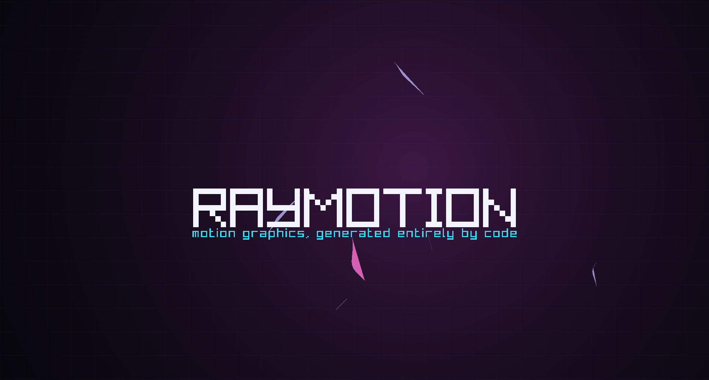

# raymotion

[](https://github.com/pebaryan/raymotion/actions/workflows/ci.yml)



Remotion-style motion graphics / video engine — pure C++17 on **raylib + ffmpeg**, no
web stack. Compositions are code: a timeline tree of nodes with keyframe/easing tracks
and transforms, drawn deterministically per frame, supersampled for clean edges, and
piped straight into ffmpeg.

## Build

Needs CMake 3.21+, a C++17 compiler, and ffmpeg on `PATH` for MP4 output.

```sh
cmake -S . -B build -DCMAKE_BUILD_TYPE=Release
cmake --build build --config Release
ctest --test-dir build -C Release --output-on-failure
```

raylib 6.2 comes from one of (`-DRAYMOTION_RAYLIB=...`):

| mode | |
|---|---|
| `auto` (default) | `vendored` with 64-bit MSVC, otherwise `fetch` |
| `vendored` | prebuilt MSVC lib in `third_party/raylib` (release `/MD`) |
| `fetch` | downloads and builds raylib 6.2 from source (Linux needs the X11/GL dev packages listed in `.github/workflows/ci.yml`) |
| `system` | `find_package(raylib 6.2)` |

CI builds Linux (full suite under Xvfb + Mesa), Windows (both raylib modes) and macOS.
Building on the original stripped-VS development machine is described in
[docs/local-toolchain.md](docs/local-toolchain.md).

## Usage

```
build/raymotion list
build/raymotion preview <name>                 # live window; esc or close quits
build/raymotion render  <name> [--crf N] [--draft] [--no-music] [--png-frames] [--ss N]
build/raymotion still   <name> --at FRAME [--png PATH] [--ss N]
build/raymotion props   <name>                 # print the default props as JSON
build/raymotion prefabs                        # list prefabs and their default props
# any command:  --props '{"title": "Hi"}'  or  --props @props.json
```

* `render` draws every frame into a composition-sized canvas and pipes raw RGBA into
  ffmpeg -> `out/<name>.mp4` (+ AAC soundtrack from the procedural synth for `music=1`
  comps). `--png-frames` writes `out/<name>_frames/fNNNNN.png` instead and needs no ffmpeg.
* ffmpeg lookup: `--ffmpeg PATH`, `RAYMOTION_FFMPEG`, a winget Gyan.FFmpeg install,
  `C:/Program Files/ffmpeg`, `C:/ffmpeg`, then `PATH`.
* Output is exactly the composition size regardless of the desktop. `--draft` renders
  half size (even dimensions) without supersampling.
* Frames carry no state: `still --at N` is identical to frame N of a full render.
* `--props` is merged (objects key by key) over the composition's `defaultProps`; the
  composition rebuilds from the result, so props can change its length or size too.

## Writing a project

The engine is the `raymotion::engine` library; a project registers compositions and
hands them to the CLI. `examples/starter/main.cpp` is a complete one:

```cpp
#include "rmtn/raymotion.hpp"
using namespace rmtn;

static void registerComps(Registry& out) {
    Comp c; c.name = "hello"; c.w = 1280; c.h = 720; c.fps = 30; c.duration = 90;
    TNode* title = addRoot(c.roots, 0, 90);
    title->props.pos = { 640, 360 };
    title->up = [](int t, NodeProps& p) {
        TrackFloat o; o.add(0, 0.f); o.add(18, 1.f, E_OUT_CUBIC); p.opacity = o.at(t);
    };
    title->fn = [](const Ctx& cx, int) {
        dr::text(fonts::ui(true), cx, "Hello, raymotion", { 0, 0 }, 64, 0, WHITE, 0.5, 0.5);
    };
    out.push_back(std::move(c));
}
int main(int argc, const char** argv) { return runCli(argc, argv, registerComps); }
```

```cmake
include(FetchContent)
FetchContent_Declare(raymotion GIT_REPOSITORY https://github.com/pebaryan/raymotion.git GIT_TAG main)
FetchContent_MakeAvailable(raymotion)
add_executable(myvideo main.cpp)
target_link_libraries(myvideo PRIVATE raymotion::engine)
```

### Authoring API

Remotion's building blocks, as C++ (the starter's `promo` composition uses all of them):

```cpp
// Timing: sequences, loops, freezes, back-to-back series.
Series s(c.roots);
s.add(60)->fn = intro;
s.add(90, -10)->fn = body;                          // overlaps the intro by 10 frames
loop(c.roots, 0, 30, 4)->fn = pulse;                // local t = 0..29, four times
freeze(c.roots, 200, 40, 15)->fn = body;            // holds the body's frame 15

// Values: interpolate (Extend / Clamp / Identity / Wrap), colours, springs, easings.
p.opacity = interpolate(t, {0, 20}, {0, 1}, clamped(ease::out(ease::cubic)));
p.scale = spring(t, {30.0});                        // fps; also config {mass, stiffness, damping}, from/to, delay
Color c = interpolateColors(t, {0, 30}, {RED, BLUE});
Easing css = ease::bezier(0.25, 0.1, 0.25, 1);

// Layers: the subtree renders offscreen, then composites as one group.
Layer& l = node->isolate();
l.opacity = 0.5f;                                   // no seams where children overlap
l.blend = Blend::Screen;                            // Normal, Add, Multiply, Screen
l.mask = [](const Ctx& cx, int t) { dr::circle(cx, {640, 360}, 10.f * t, WHITE); };

// Transitions between scenes (fade / slide / wipe, with a direction and easing).
TransitionSeries ts(c.roots, c.w, c.h);
ts.add(90)->fn = sceneA;
ts.transition(Transition::slide(20, Direction::FromRight));
ts.add(90)->fn = sceneB;
c.duration = ts.end();

// Layout: flex rows/columns, grids, wrapped and aligned text boxes.
auto cols = layout::row(layout::inset(layout::fill(c.w, c.h), 64), {layout::px(320), layout::flex()}, 24);
dr::textBox(cx, "Wraps to the box, aligned", cols[1], {fonts::ui(true), 48});

// Props: defaults + a build step that runs with the merged input props.
c.defaultProps = Json::parse(R"({"title": "Hello", "accent": "#47dad8"})");
c.build = [](Comp& c, const Json& props) {
    /* read props.str("title", ""), props.color("accent", WHITE), ...; fill c.roots */
};

// Prefabs: named, parameterized subtree builders, registered once and instantiated
// anywhere (Remotion-style components). The caller owns timing; props merge over the
// prefab's defaults exactly like a composition's.
prefab::add({ "card", Json::parse(R"({"accent": "#47dad8", "delay": 0})"),
              [](TNode& n, const Json& p) {
                  n.up = [d = p.integer("delay", 0)](int t, NodeProps& pr) {
                      pr.opacity = (float)interpolate(t - d, { 0, 15 }, { 0, 1 }, clamped());
                  };
                  /* fill n.kids, add audio, isolate() a layer, ... */
              } });
prefab::use(root, 30, 60, "card", Json{{"title", "Fast"}});   // root->add(30, 60) + apply
```

### GPU 3D

`rmtn/scene3d.hpp` puts Three.js-style scenes on the timeline (like `@remotion/three`):

```cpp
auto scene = std::make_shared<g3d::Scene>();
scene->camera.position = {0, 3, 8};
scene->add(g3d::Geometry::plane(20, 20), {mkColor(0x30364a), 0.9f});      // color, roughness
g3d::Object3D* knot = scene->add(g3d::Geometry::knot(1, 0.35f), {mkColor(0x47dad8), 0.25f});
knot->up = [](int t, g3d::Object3D& o) { o.position.y = 1.5f; o.rotation.y = t * 2.f; };
scene->lights.push_back(g3d::Light::directional({-6, 12, 5}, WHITE, 1.1f, /*shadow*/ true));
scene->lights.push_back(g3d::Light::spot({6, 7, 6}, {0, 0, 0}, ORANGE, 2, 24));
scene->fogNear = 14; scene->fogFar = 34;
scene->environmentGenerator = g3d::studioEnvironment(mkColor(0x3a4670), mkColor(0x1a2036), BLACK);
scene->camera.dof = {/*focusDistance*/ 12, /*aperture*/ 1.2f, /*maxBlur*/ 10};

addRoot(c.roots, 0, 240)->fn = g3d::draw(scene);                          // full frame
addRoot(c.roots, 60, 180)->fn = g3d::draw(scene, {1376, 716, 480, 300}, topCamera);  // inset view
```

* Shapes (box, sphere, plane, cylinder, cone, torus, torus knot) and model files
  (`g3d::loadModel`: glTF/GLB, OBJ, IQM, M3D, VOX) with their textures; glTF skeletal
  animations play on the GPU (`object->animation`, `animationFrame`).
* Materials: colour/texture, roughness, metalness, emissive, opacity (sorted
  transparency), unlit, double-sided. Lighting is in linear space with sRGB output.
* Lights: up to 8 directional/point/spot lights with range falloff. Any of them can cast
  PCF shadows; they share one shadow atlas (`shadowMapSize` per tile, a tile per
  directional/spot light and six per point light, 16 tiles), with `shadowBias` in world
  units on top of an automatic slope bias. Linear fog.
* Ambient light is a sky/ground hemisphere, or image-based: `scene->environment` (an
  equirectangular PNG/JPG/HDR) or `environmentGenerator` (e.g. `g3d::studioEnvironment`,
  a gradient with soft light boxes) lights diffuse surfaces from its blurred mips and
  gives reflections that blur with roughness; `showEnvironment` draws it as a skybox.
* Depth of field per camera (`camera.dof`): a golden-angle gather blur from the depth
  buffer, sized in composition pixels so it looks the same at every supersampling level.
* Object hierarchy with Euler transforms; every object, light and camera has an `up`
  callback driven by the node's local frame.
* A scene renders offscreen at canvas resolution (so it is supersampled), then
  composites over the 2D content under it with the node's opacity, in any viewport.
  `gpu-3d` renders 240 frames of 1080p with IBL, two shadow casters and DOF in about 4 s.

### Engine pieces

* `rmtn/timeline.hpp` — `Comp`, the node tree (start/duration, `up` animates props,
  `fn` draws), easings, float/vec/color keyframe tracks, transform ctx, per-frame RNG.
* `rmtn/draw.hpp` — primitives through the node ctx: quads, gradients, round rects,
  rings/arcs/sectors, stars, blobs, any simple polygon (ear-clipped), text.
* `rmtn/render.hpp` — `Canvas`: supersampled antialiasing. `Comp::supersample` (default
  2, or `--ss 1|2|4`) draws at N x size and box-filters down, so edges, lines and glyphs
  are smooth while you keep working in composition coordinates. `Comp::render` replaces
  the tree with a custom multi-pass renderer; `onGraphicsShutdown` releases its GL objects.
* `rmtn/fonts.hpp` — `fonts::ui()` is the bundled Inter (SIL OFL); `fonts::load({...})`
  finds files in project assets, `RAYMOTION_ASSETS`, then system font dirs, caches them
  with mipmapped filtering, and throws instead of silently substituting.
* `rmtn/anim.hpp` — `interpolate`, `interpolateColors`, `spring`/`measureSpring`, `ease::`.
* `rmtn/transitions.hpp` — `TransitionSeries` with fade, slide and wipe.
* `rmtn/layout.hpp` — `layout::` rects, rows, columns, grids; `wrapText`, `dr::textBox`.
* `rmtn/scene3d.hpp` — `g3d::` GPU scenes: geometry, models, materials, lights, shadows,
  environments, cameras with depth of field.
* `rmtn/json.hpp` — `Json` values for props (parse, typed lookups with fallbacks, merge).
* `rmtn/prefab.hpp` — `prefab::add/use`: registered, parameterized subtree builders.
* `rmtn/synth.hpp` — sine-sum note events + envelopes -> WAV soundtrack.
* `rmtn/cli.hpp` — `runCli`: list / preview / render / still / props / prefabs.

## Showcase

`build/raymotion` runs `examples/showcase`:

```
probe                  1280x720  @30fps    2.0s  music=0
demo-neon              1920x1080 @30fps    7.5s  music=1
geo-orbit              1920x1032 @30fps    9.0s  music=1   (procedural CPU 3D)
fx-1-overlays          1920x1032 @30fps   10.0s  music=1   (overlay shader)
fx-2-bloom             1920x1032 @30fps   10.0s  music=1   (+ CPU quarter-res bloom)
fx-3-gpulit            1920x1032 @30fps   10.0s  music=1   (+ CPU painter-lit meshes; historical name)
fx-4-max               1920x1032 @30fps   10.0s  music=1   (full composite)
gpu-3d                 1920x1080 @30fps    8.0s  music=0   (GPU scene: IBL, shadows, DOF, fog, inset camera)
here-there-explainer   1280x720  @30fps  108.0s  music=1   (logic explainer)
here-there-plain       1280x720  @30fps  108.0s  music=0   (plain-language cut, Segoe UI)
here-there-feed        1080x1350 @30fps   88.0s  music=0   (portrait feed cut, Segoe UI)
own-your-compute       1920x1080 @30fps   66.0s  audio=1   (story film: GPU 3D, particles, glitch; all assets from code)
```

The Here-and-There pieces introduce Pedro Cabalar's treatment of HT and equilibrium
logic; sources, script and scope notes are in `docs/here-there-explainer.md`, and the
worked examples are checked by the `ht_semantics` test.

`own-your-compute` is a 66 s short about running AI on your own machine, built to show
the engine off: a fogged server aisle with blinking LEDs, glitch stamps with RGB split and
screen shake, a particle cloud pouring into a chip, a procedural graphics card with
spinning fans and depth of field, a neural net firing, an offline terminal, and a dawn
island under a privacy dome. Every mesh (terrain, roof, dome), texture (PCB, wood, rack
panels), the sky and the score (saw pads, drums, delay and reverb, synthesised in
`examples/showcase/own_compute.cpp`) is generated by code into `out/oyc-assets-v2/` on
first use. The plain and feed cuts are laid
out for Segoe UI and refuse to substitute another font (their tests skip without it).

## Tests

`ctest` runs: HT semantics and the authoring API (interpolation, springs, timing,
transitions, layout, JSON; pure logic); layer compositing (group opacity, blend modes,
masks, offsets at every supersampling level, wipes, text boxes); GPU 3D (placement and
depth, lighting, directional/spot/point and multi-light shadows, environment lighting and
skybox, depth of field, viewports, transparency, hierarchy, OBJ and a generated skinned
glTF, determinism); renderer regressions (supersampling edge levels
and coordinates, concave fills, fonts, FX shader uniforms, determinism, shutdown);
Here-There layout checks; and a Python CLI suite (exact sizes, draft scaling, stale-frame
cleanup, a real MP4 render, the starter project, props). Tests needing OpenGL carry the `gl`
label (`ctest -LE gl` skips them on headless machines).

Inter is © The Inter Project Authors, SIL Open Font License 1.1
(`assets/fonts/Inter-OFL.txt`). raylib is zlib-licensed.
